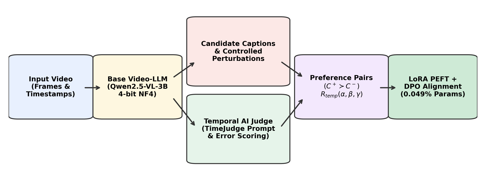
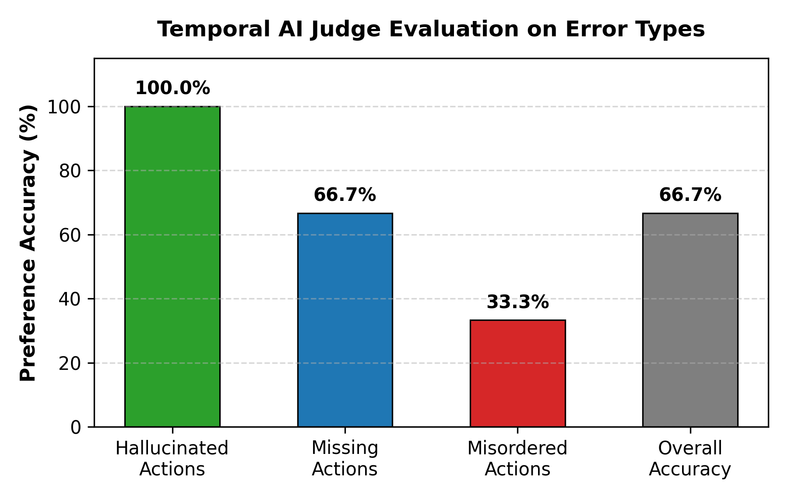
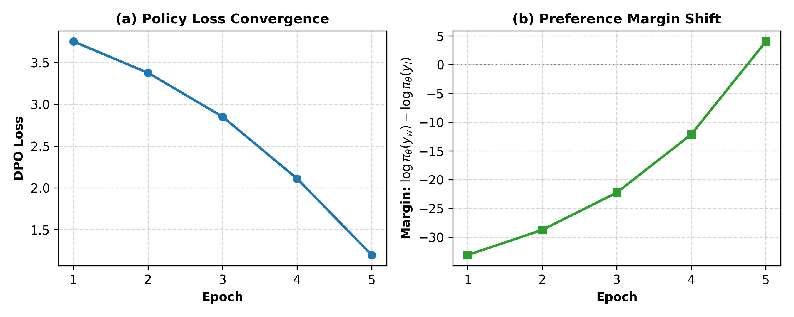

# Temporal-Consistency-Aware Reinforcement Learning from AI Feedback for Video-Language Models

[](https://www.python.org/)
[](https://pytorch.org/)
[](https://huggingface.co/)
[](LICENSE)

Course Project on Multimodal Reinforcement Learning  
**Department of Computer Science and Engineering, Indian Institute of Technology Bhilai**  
**Authors**: Himanshi (12340940) & Jiya Mehta (12341020)

---

## Overview

Video-Large Language Models (Video-LLMs) excel at identifying individual visual objects and scenes. However, they frequently struggle with **temporal consistency**, exhibiting systematic errors such as:
1. **Misordered Actions**: Describing chronological events in reverse or scrambled order.
2. **Missing Actions**: Omitting essential intermediate milestones.
3. **Hallucinated Actions**: Inventing fictitious camera cuts and actions unsupported by video evidence.

This project introduces a **Temporal-Consistency-Aware Reinforcement Learning from AI Feedback (RLAIF)** framework inspired by *TimeJudge* and *VLM-RLAIF*. By constructing controlled temporal perturbation pairs ($C^+ \succ C^-$) and formulating an explicit temporal reward function $R_{\text{temp}} = \alpha R_{\text{order}} + \beta R_{\text{missing}} + \gamma R_{\text{hall}}$, we align a 4-bit quantized `Qwen2.5-VL-3B` policy using **Low-Rank Adaptation (LoRA)** and **Direct Preference Optimization (DPO)**.

---

## System Architecture



The alignment pipeline consists of four major stages:
1. **Multimodal Evidence Extraction**: Dense chronological keyframes and timestamps sampled across video sequences.
2. **Temporal AI Judge**: A multimodal judge evaluating candidate descriptions across missing, hallucinated, and misordered actions.
3. **Preference Modeling**: Ground-truth preference pairs generated via systematic action order swaps, deletions, and hallucination injections.
4. **Parameter-Efficient RL (LoRA + DPO)**: Optimizing only **0.049%** of model parameters on consumer GPU hardware (Google Colab).

---

## Key Experimental Results

### 1. Diagnostic Findings: The Temporal Vulnerability
Testing the zero-shot Video-LLM as an AI judge revealed a stark asymmetry:
* **Hallucination Detection Accuracy**: **100.0%**
* **Missing Action Accuracy**: **66.7%**
* **Misordered Event Detection Accuracy**: **33.3%**

Standard Video-LLMs easily spot nonexistent objects, but are largely blind to reversed chronological event order—empirically motivating our temporal feedback framework.



### 2. DPO Training Convergence
Fine-tuning the 4-bit Qwen2.5-VL-3B model with LoRA ($r=8$) over 5 epochs demonstrated rapid and stable convergence:
* **Trainable Parameters**: 1,843,200 out of 3.75B (**0.049%**)
* **DPO Loss**: Monotonically decreased from **3.7531 down to 1.1943**
* **Preference Margin ($\log \pi_w - \log \pi_l$)**: Shifted from **-33.09 to +3.99** (+37.08 net gain in favor of chronologically faithful captions).



### 3. Qualitative Comparison & Head-to-Head Evaluation
* **Baseline Video-LLM**: Suffered from repetitive hallucinatory switching loops (describing transitions between the control room and ISS four separate times).
* **RL-Aligned Video-LLM**: Strictly followed the true chronological progression, accurately identified text overlays ("Expedition 30"), grounded details (NASA logos, blue shirts), and completely eliminated hallucinatory loops.
* **Blind AI Judge Verdict**: Explicitly selected the RL-aligned caption as the winner with **zero temporal errors**.

---

## Repository Structure

```text
├── final_report.tex                 # Complete IEEE-style project research report (LaTeX)
├── rl_project_(1).ipynb             # Complete Google Colab notebook with full execution logs
├── sop_rl.pdf                       # Original Statement of Purpose & project proposal
├── figures/                         # 300 DPI publication-grade figures
│   ├── pipeline_architecture.png
│   ├── video_frames.jpg
│   ├── judge_accuracy.png
│   ├── training_curves.png
│   └── reward_ablation.png
├── temporal_project_results/        # Exported experimental datasets and models
│   └── content/temporal_project/
│       ├── temporal_preference_dataset.csv / .json
│       ├── ai_judge_evaluation_results.csv
│       ├── rl_training_history.csv
│       ├── FINAL_MODEL_COMPARISON.csv
│       ├── REWARD_ABLATION_STUDY.csv
│       ├── FINAL_PROJECT_REPORT.md
│       └── temporal_lora_adapter/   # Trained LoRA adapter weights & config
└── video_contact_sheets/            # Extracted visual contact sheets
```

---

## Getting Started & Reproduction

### Prerequisites
Run on Google Colab with a GPU (T4, L4, or A100):
```bash
pip install -q -U torch torchvision transformers accelerate bitsandbytes peft opencv-python
```

### Running the Notebook
Open and run `rl_project_(1).ipynb` in Google Colab. The notebook executes:
1. Model loading (`Qwen/Qwen2.5-VL-3B-Instruct` in 4-bit NF4)
2. Frame extraction & baseline caption generation
3. Controlled perturbation & preference dataset synthesis
4. LoRA adapter attachment & Direct Preference Optimization (DPO)
5. Model evaluation, reward component ablation, and report export

---

## References

1. D. Ahn, Y. Choi, Y. Yu, D. Kang, and J. Choi, *"Tuning Large Multimodal Models for Videos using Reinforcement Learning from AI Feedback,"* ACL 2024.
2. Y. Hu, Z. Song, J. Yu, Y. P. Chen, and W. Yang, *"TimeJudge: Empowering Video-LLMs as Zero-Shot Judges for Temporal Consistency in Video Captions,"* FITEE 2025.
3. R. Rafailov, A. Sharma, E. Mitchell, S. Ermon, C. D. Manning, and C. Finn, *"Direct Preference Optimization: Your Language Model is Secretly a Reward Model,"* NeurIPS 2023.
4. E. J. Hu et al., *"LoRA: Low-Rank Adaptation of Large Language Models,"* ICLR 2022.
